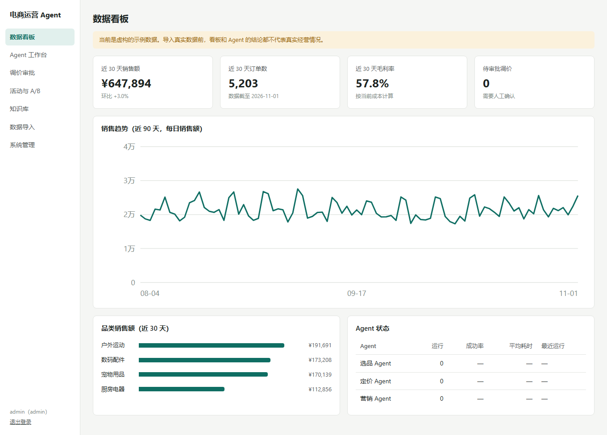
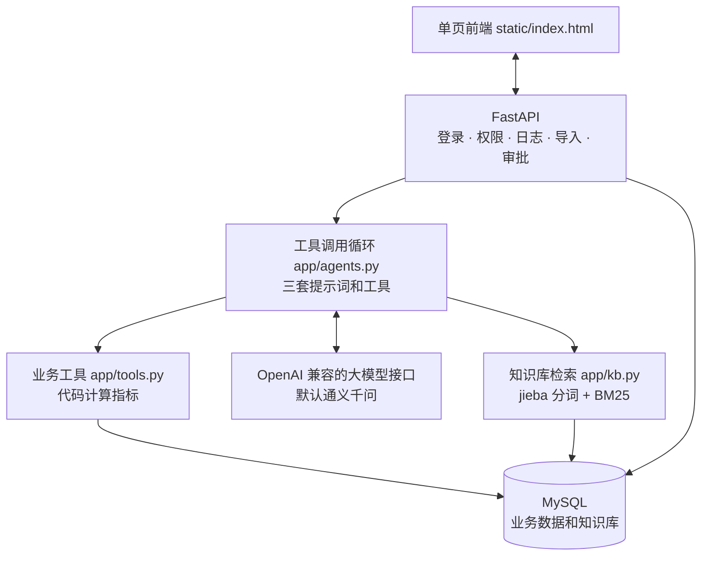

# 电商运营 Agent

给中小电商运营团队用的本地工具：用选品、定价、营销三个 Agent 分析业务数据，并配有知识库、数据看板、调价审批和权限管理。

指标由代码计算，大模型负责调用工具和解读结果；调价必须经人工批准。

   

## 成品展示



截图是首次启动后的数据看板，使用的是项目自带的**虚构示例数据**，不代表真实经营情况。截图时还没有运行过 Agent，所以 Agent 状态为空。

## 它解决什么问题

中小团队的运营工作常常卡在这几个地方：

| 问题 | 这个项目的做法 |
|---|---|
| 选品、定价要在多张表之间来回汇总 | 导入 CSV 后，用自然语言让 Agent 分析 |
| 模型可能编造数字 | 指标由代码计算，模型只能引用工具结果 |
| 自动调价有风险 | Agent 只能提交建议，由人工审批，并限制最低毛利率和单次调价幅度 |
| 平台规则和内部手册难查 | 知识库问答标注出处，检索不到时不调用模型 |
| 多人使用时权限和记录混乱 | 区分管理员、运营和只读账号，并保留操作日志 |

## 功能

| 模块 | 能做什么 |
|---|---|
| 选品 Agent | 品类分析、竞品监控、市场调研、选品推荐 |
| 定价 Agent | 成本定价、竞品参考、动态调价、利润优化、提交调价建议 |
| 营销 Agent | 文案生成、活动策划、受众分析、A/B 测试 |
| 调价审批 | 查看建议，批准后才修改本系统内的售价 |
| 知识库 | 导入 `.txt`、`.md`，问答时标注出处 |
| 数据看板 | KPI、销售趋势、品类销售额、Agent 运行状态 |
| 数据导入 | 用 CSV 导入商品、订单、竞品价格、市场趋势、选品候选 |
| 系统管理 | 用户权限、模型和护栏配置、操作日志 |

## 系统架构



**一次 Agent 任务的过程：** 用户提出任务后，模型选择要调用的工具，程序执行工具并返回结果；模型继续分析，直到写出结论或达到调用轮数上限。

| 层 | 技术 | 这样选的原因 |
|---|---|---|
| 前端 | 单个 HTML 文件 | 不需要构建 |
| 后端 | FastAPI、SQLAlchemy | 接口和权限清晰，自带参数校验 |
| 数据库 | MySQL 8.4 | 存放业务数据和知识库，启动脚本可自动安装 |
| Agent | 自研工具调用循环 | 代码少，没有引入 Agent 框架 |
| 检索 | jieba + BM25 | 知识库规模小，不需要向量数据库 |
| 测试 | pytest | 用临时 SQLite 和假的模型响应，不花费用 |

## 护栏

| 护栏 | 做法 |
|---|---|
| 人工审批 | 定价 Agent 只能提交建议，批准后才改价 |
| 调价范围 | 限制最低毛利率（默认 10%）和单次调价幅度（默认 15%），可在系统管理中修改 |
| 数字来源 | 提示词要求数字和事实必须来自工具结果，数据不足时要说明 |
| 提示注入 | 提示词要求把工具返回的内容当作数据，不执行其中的指令 |
| 营销文案 | 没有依据的款式、材质、功能写成“待确认”，不当作事实 |
| 调用上限 | 单次任务默认最多调用 6 轮工具 |
| 访问范围 | 服务默认只监听本机，并要求登录 |

提示词类护栏是软约束，模型不一定完全遵守，关键结果仍要人工检查。

## 快速开始

**需要：** Windows 10/11、Python 3.11 ~ 3.14、联网。使用 Agent 和知识库问答还需要一个大模型 API Key。

```bash
git clone <仓库地址>
```

```bash
cd ecom-agent
```

然后双击 `start.bat`。首次运行会自动完成：

1. 创建 `.venv` 并安装依赖。
2. 下载并校验 MySQL 8.4 免安装版（约 270 MB），放在 `%LOCALAPPDATA%\EcomAgent`。
3. 生成 `.env`，包含随机密码和默认的模型配置。
4. 初始化数据库，写入虚构的示例数据，然后打开浏览器。

**登录：** 用户名是 `admin`，密码是 `.env` 里的 `ADMIN_PASSWORD`。

**填写 API Key：** 打开 `.env`，把 Key 粘在 `LLM_API_KEY=` 后面并保存，再次双击 `start.bat`。没有 Key 时，看板、审批、导入和系统管理仍可使用，Agent 和知识库问答不可用。

**关闭：** 关掉 `start.bat` 打开的窗口。MySQL 会继续在后台运行，重启电脑后才停止；它不注册系统服务，也不会开机自启。

MySQL 默认用 33061 端口，应用默认用 8000 端口；被占用时首次运行会自动换一个，实际端口记录在 `.env`。

### 配置项（`.env`）

`.env` 由 `start.bat` 自动生成，也可以参考 `.env.example`。不要提交它，也不要发给别人。

| 配置 | 说明 |
|---|---|
| `LLM_API_KEY` | 大模型 Key，手动填写。留空时读取环境变量 `DASHSCOPE_API_KEY` |
| `LLM_BASE_URL` | 接口地址，默认是通义千问的 OpenAI 兼容接口 |
| `LLM_MODEL` | 默认 `qwen3.8-flash`。只在首次启动时生效，之后到“系统管理”修改 |
| `ADMIN_PASSWORD` | 只在首次启动时创建管理员。之后修改要运行 `python -m app.reset_admin` |
| `MYSQL_ROOT_PASSWORD` | 只在首次初始化时生效，之后修改不会改变 MySQL 实际的密码 |
| `APP_PORT` | 应用端口 |
| `MYSQL_HOME`、`MYSQL_DATA` | 使用已有的 MySQL 免安装版和数据目录 |
| `ECOM_PYTHON` | 使用现有 Python 环境，不创建 `.venv`，缺包时需自行安装 |

**换模型：** 其他 OpenAI 兼容服务改 `LLM_BASE_URL`、`LLM_API_KEY` 和模型名即可。

## 换成真实数据

下面的命令会**清空全部业务数据**，保留账号和配置：

```bash
python -m app.seed --clear
```

之后在“数据导入”页面上传 CSV，先导入商品，再导入订单和竞品价格。

| 类型 | 必填列 | 选填列 |
|---|---|---|
| 商品 `products` | `sku,name,category,cost,price` | `stock` |
| 订单 `orders` | `sku,quantity,unit_price,order_date` | `segment,region` |
| 竞品价格 `competitor_prices` | `sku,competitor,price,captured_on` | 无 |
| 市场趋势 `market_trends` | `category,month,search_index,avg_price` | 无 |
| 选品候选 `candidates` | `name,category,est_cost,est_price,monthly_demand,growth,competitor_count` | 无 |

- 表头必须是这些英文字段名，顺序不限，多余的列会被忽略。
- 日期写成 `2026-01-31`，月份写成 `2026-01`，数字不要带货币符号。
- 任一行出错会整批撤销。除商品按 SKU 更新外，重复导入同一份文件会重复累加。

## 项目结构

```text
app/
  main.py         接口、登录、权限、导入、审批
  agents.py       工具调用循环和三个 Agent 的提示词
  tools.py        选品、定价、营销的业务工具
  kb.py           知识库分词和检索
  models.py       数据表
  config.py       读取配置
  seed.py         虚构示例数据
  reset_admin.py  重置管理员密码
static/
  index.html      单页前端
tests/            接口和业务逻辑测试
docs/             README 的截图
start.bat         Windows 一键启动入口
start.ps1         安装依赖、MySQL 并启动应用
package.ps1       打包成可发送的 zip，不含 .env 和 .venv
```

## 测试

测试默认使用临时 SQLite 和假的模型响应，不需要 MySQL 和 API Key。

```bash
pip install -r requirements.txt
```

```bash
python -m pytest tests -q
```

共 22 个测试，覆盖接口和业务逻辑。设置 `TEST_DATABASE_URL` 可以跑在 MySQL 上，注意测试会清空该库。

这些测试不调用真实大模型，所以不能说明模型回答的质量。

## 局限

- **没有真实业务效果数据：** 项目使用虚构示例数据演示，没有在真实店铺验证过。
- **不直接对接电商平台：** 数据靠 CSV 导入，批准调价只修改本系统内的售价。
- **不抓取数据：** 竞品价格和市场趋势需要自己提供。
- **利润优化只是估算：** 基于历史订单估算弹性，没有考虑促销和季节因素。
- **A/B 测试要手动录入：** 曝光和转化要在平台跑完后录入。
- **默认只适合本机使用：** 要让他人通过网络访问，需要另外配置 HTTPS 和登录限流。
- **启动脚本只支持 Windows：** Mac 和 Linux 需要手动部署。

## 许可

[MIT License](LICENSE)
